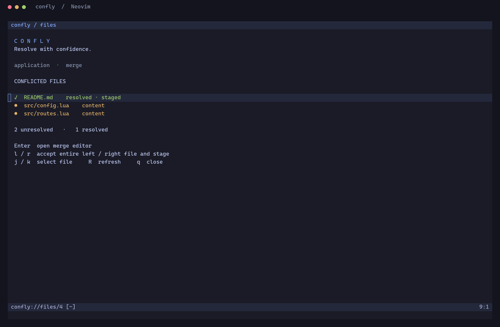
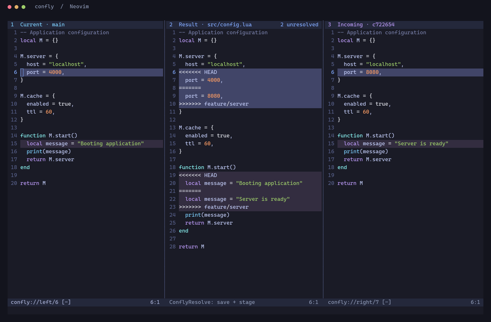
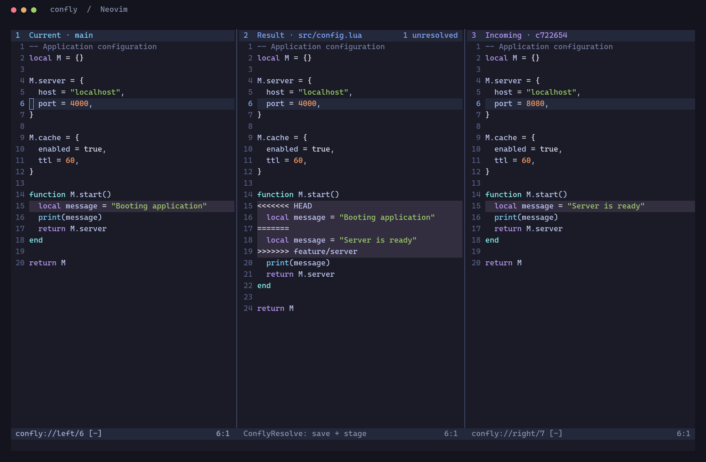

# confly

A JetBrains-inspired merge-conflict workflow for Neovim.

**Choose a file. Compare both sides. Build your result in the middle.**

Confly provides a conflicted-file picker, three-pane editing, conflict-only
highlighting, and keyboard-driven resolution. Written in Lua; no runtime
dependencies beyond Neovim and Git.

[Install](#installation) · [Workflow](#workflow) · [Keys](#keys) ·
[Configuration](#configuration) · [Screenshots](#screenshots)

## Screenshots

### Choose a conflicted file

Open a file with `Enter`, or accept its entire left/right version with `l` / `r`.
Successfully resolved files stay visible with a green checkmark.



### Compare and resolve

The current version is on the left, your editable result is in the middle, and
the incoming version is on the right. Only conflict regions receive Confly's
background highlights.

Status-line hints show the resolution keys. Press `?` in any merge pane for
the full key guide, including your configured mappings; close it with `q` or `Esc`.



### Build the result

Accepting a side replaces that conflict in the result and removes its conflict
highlight. Continue through the remaining conflicts, then save and stage.



These are captures of the running plugin's Neovim UI grid, rendered with a
monospace font. [The capture script](scripts/capture.py) reproduces them using a
synthetic demo repository named `application` with real merge conflicts.
The file picker displays the repository name rather than its absolute path.

## Requirements

- Neovim **0.10.4+**
- Git on `PATH`
- At least 90 terminal columns for the three-pane editor

Run `:checkhealth confly` to check your setup.

## Installation

### lazy.nvim

Add this to your plugin specifications:

```lua
{
  "AndresDuque/confly",
  main = "confly",
  cmd = { "Confly", "ConflyFiles", "ConflyResolve", "ConflyClose" },
  opts = {},
  keys = {
    { "<leader>gm", "<cmd>Confly<cr>", desc = "Resolve Git conflicts" },
  },
}
```

Install with `:Lazy sync`, restart Neovim, and run `:Confly`.

### lazy.nvim — local development

To work on a local checkout, use its directory instead:

```lua
{
  dir = vim.fn.expand("~/projects/confly"), -- adjust to your checkout
  name = "confly",
  main = "confly",
  cmd = { "Confly", "ConflyFiles", "ConflyResolve", "ConflyClose" },
  opts = {},
}
```

### Native Neovim packages

Find your Neovim data directory:

```vim
:echo stdpath('data')
```

Clone the repository into `<data directory>/site/pack/plugins/start/confly`:

```sh
git clone https://github.com/AndresDuque/confly.git "<data directory>/site/pack/plugins/start/confly"
```

Replace `<data directory>` with the value above. Restart Neovim. Configuration
is optional:

```lua
require("confly").setup({})
```

For a quick trial without a plugin manager:

```sh
git clone https://github.com/AndresDuque/confly.git
nvim --cmd "set runtimepath+=./confly"
```

## Workflow

1. Start a merge, rebase, or cherry-pick in Git or lazygit.
2. Return to Neovim and run **`:Confly`**.
3. Select a conflicted file with `j` / `k`, then press `Enter`.
4. Focus the left or right pane. Use `j` / `k` to navigate conflicts.
5. Press **`c`** to accept that side, or **`d`** to discard that side and use the
   opposite version. Press `b` to include both, left first.
6. For a custom result, edit the middle pane normally. Remove its conflict
   markers, then press `<leader>cc` to confirm that region.
7. Run **`:ConflyResolve`** or press `<leader>cs` to save and stage this file.
8. The file picker returns, showing a green **✓** next to the resolved filename.
9. Resolve the remaining files, then return to Git or lazygit to continue.

The middle pane initially preserves the working file, including Git's conflict
markers and any existing unsaved edits. Confly decisions remove the markers for
the chosen region.

### Whole-file shortcuts

In the file picker:

- **`l`** accepts and stages the complete left version.
- **`r`** accepts and stages the complete right version.

These choose the **entire file**, including changes outside conflict regions.
Accepting a missing side resolves the file as deleted. Binary conflicts use
these whole-file shortcuts too.

### What “resolved” means

Choosing a conflict in the editor changes your result buffer. `:ConflyResolve`
saves it and stages **only that path**. A green check appears only after Git
confirms the path no longer has unmerged index entries.

Confly does not create commits or continue a merge/rebase. Review your staged
changes and continue using your usual Git workflow.

### Which side is which?

| Operation | Left: Git stage 2 | Right: Git stage 3 |
| --- | --- | --- |
| Merge | Current branch | Incoming branch/commit |
| Rebase | Version being rebased onto | Commit being replayed |
| Cherry-pick | Current branch | Picked commit |

During a rebase, “ours” is **not necessarily your feature branch**. Confly's pane
headers name the operation context and show branch names or commit IDs.

## Keys

All plugin mappings are buffer-local and configurable.

| Where | Key | Action |
| --- | --- | --- |
| File picker | `j` / `k` | Next / previous file |
| File picker | `Enter` | Open the merge editor |
| File picker | `l` / `r` | Accept and stage the entire left / right file |
| File picker | `R` | Refresh |
| File picker | `q` | Close Confly |
| Left/right panes | `j` / `k` | Next / previous conflict |
| Left/right panes | `c` | Accept this side |
| Left/right panes | `d` | Discard this side; accept the opposite |
| Left/right panes | `b` | Include both sides, left then right |
| Left/right panes | `u` | Undo the latest result edit/decision |
| Any merge pane | `]x` / `[x` | Next / previous conflict |
| Any merge pane | `?` | Show merge key guide (`q` / `Esc` to close) |
| Any merge pane | `Ctrl+1` / `Ctrl+2` / `Ctrl+3` | Focus left / result / right |
| Any merge pane | `<leader>c1` / `<leader>c2` / `<leader>c3` | Fallback pane focus |
| Any merge pane | `<leader>cu` | Undo the latest result edit/decision |
| Any merge pane | `<leader>cf` | Return to files |
| Any merge pane | `<leader>cs` | Save and stage the resolved file |
| Result pane | `<leader>cc` | Confirm a manually edited conflict |

The result pane keeps ordinary Neovim editing, including `j`, `k`, `c`, `d`, and
native undo/redo. Navigation wraps through the conflict regions in the open file,
including ones already resolved, so you can revisit a choice.

Many terminals cannot transmit Ctrl+number distinctly. Use the `<leader>c1/c2/c3`
fallbacks, or configure your terminal's extended keyboard protocol.

## Configuration

Pass these options to `setup`, or use `opts` with lazy.nvim:

```lua
require("confly").setup({
  icons = true,          -- false: use [ok] / [!] instead of Unicode icons
  ctrl_numbers = true,   -- also map Ctrl+1, Ctrl+2, Ctrl+3
  keys = {
    j = "j",
    k = "k",
    open = "<CR>",
    left = "l",
    right = "r",
    refresh = "R",
    close = "q",
    accept = "c",
    discard = "d",
    both = "b",
    source_undo = "u",
    undo = "<leader>cu",
    confirm = "<leader>cc",
    next = "]x",
    prev = "[x",
    files = "<leader>cf",
    resolve = "<leader>cs",
    pane1 = "<leader>c1",
    pane2 = "<leader>c2",
    pane3 = "<leader>c3",
    help = "?",
  },
})
```

Set an individual key to `false` to disable that mapping.

Highlight groups: `ConflyTitle`, `ConflyMuted`, `ConflyConflict`, `ConflyActive`,
`ConflyResolved`, `ConflyPending`, `ConflyLeft`, and `ConflyRight`. Override them
with `vim.api.nvim_set_hl`.

## Commands

| Command | Purpose |
| --- | --- |
| `:Confly` | Open conflicted files for the current buffer's repository |
| `:ConflyFiles` | Return to / refresh the file picker |
| `:ConflyResolve` | Save and stage the current resolved file |
| `:ConflyClose` | Close Confly; keep unsaved result buffers |
| `:checkhealth confly` | Check dependencies |

Help: `:help confly` (native installs may need `:helptags <plugin path>/doc`).

## License

[MIT](LICENSE)
